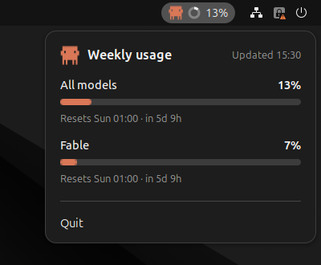

# AI Usage Tray Indicator

This repository holds two ways to keep an eye on your Claude plan usage:

| | Runs on | What it does |
| --- | --- | --- |
| [AI Usage agent](#ai-usage-agent) | Windows, macOS, Ubuntu 22.04, 24.04 and 26.04 | Tray icons and a usage panel with your Claude and Codex usage. It also reports the numbers to your team's AI Usage server, and you install it from that server. |
| [GNOME Shell extension](#gnome-shell-extension) | Ubuntu 24.04 (GNOME 46) | The original: a ring and a percentage in the top bar, for you alone. |

Use one of them on a PC, not both. Each asks Anthropic for the numbers on its
own, so together they make twice the requests.

The extension, at a glance (its details are [further down](#gnome-shell-extension)):

A GNOME Shell extension that shows your Claude plan usage in the Ubuntu top
bar, so you don't have to keep opening the usage page on claude.ai.



- **Top bar:** a ring gauge and your weekly usage across all models, as a
  percentage.
- **Click:** a card with two bars, weekly usage for all models and for Fable,
  each with its reset time.
- It always shows the last numbers it fetched successfully. It refreshes every
  5 minutes in the background and again the moment you open the card.

> Unofficial. Not affiliated with or endorsed by Anthropic. It relies on an
> undocumented endpoint, which may change or stop working without notice.

## AI Usage agent

A small program that runs for your OS user. It shows your usage in the
tray (the Windows notification area, the macOS menu bar, the Ubuntu top bar)
and in the usage panel that opens from it, and sends it to your team's AI
Usage server, whose dashboard shows the whole team. Only one PC per Claude
account asks Anthropic at a time: the server picks it, and every other PC on
that account gets the numbers from the server.

### What it sends

To your team's server, and nowhere else. (The server also sees this PC's IP
address, as any server you connect to does.)

- Anthropic's whole usage reply for each fetch, with when it was fetched and
  its HTTP status: the percentage of each limit, the reset times, the
  per-product breakdown and the extra-usage spend
- The account: its ID, email, display name, organization name and type,
  plan and rate-limit tier
- When Codex is signed in on this PC: OpenAI's whole Codex usage reply for
  each fetch (the percentage, length and reset time of each limit window,
  per-model limits, whether there are credits and their balance), with when
  it was fetched, its HTTP status and how it was fetched; and the Codex
  account: its e-mail, plan, ChatGPT account ID and user ID
- This PC: a random ID made at the first run, the PC name, your OS user
  name, the OS and its version, and the CPU type
- A key that tells the server this PC apart from others, so that the
  dashboard counts a reinstalled PC once: a keyed hash (HMAC-SHA256) of the
  OS's own machine identifier (Linux machine-id, Windows MachineGuid, macOS
  host UUID), which is sent only as this hash. The identifier is a random
  128-bit value, so the key cannot be turned back into it; someone who
  already has this PC's identifier could compute the key and so recognise
  the PC, nothing more. When the OS gives no identifier, no key is sent and
  a reinstall counts as a new PC. No network adapter (MAC) address is used.
- The agent: its version, and whether it shows a tray icon
- The sign-in: whether Claude Code (and Codex) is signed in, and when the
  sign-in expires; on a PC without Codex, that Codex is not signed in
- Whether you asked for fresh numbers with **Refresh now**
- When you remove the agent: one last request that says so, so the server
  stops counting this PC at once

Field by field, every sync request carries `schema`, `client.version`,
`client.os`, `client.os_version`, `client.arch`, `client.mode`, `device.id`,
`device.hostname`, `device.os_user`, `machine.key`, `machine.source`,
`event`, and one entry per provider with `providers[].provider`,
`providers[].account.key`, `providers[].account.email`,
`providers[].account.display_name`, `providers[].account.organization_name`,
`providers[].account.organization_type`,
`providers[].account.subscription_type`,
`providers[].account.rate_limit_tier`, `providers[].account.plan_type`,
`providers[].auth.state`, `providers[].auth.token_expires_at`,
`providers[].parse_problem` (whether the agent could read the reply),
`providers[].results[].account_key`, `providers[].results[].fetched_at`,
`providers[].results[].http_status`, `providers[].results[].usage`,
`providers[].results[].source`, `providers[].results[].cli_version`,
`providers[].results[].detail`, `providers[].results[].retry_after_seconds`
(how long the service asked to wait) and `providers[].want_fresh`.
A server that does not know this request yet gets the older one instead,
for Claude only: `schema`, `client.version`, `client.os`,
`client.os_version`, `client.arch`, `client.mode`, `device.id`,
`device.hostname`, `device.os_user`, `account.uuid`, `account.email`,
`account.display_name`, `account.organization_name`,
`account.organization_type`, `account.subscription_type`,
`account.rate_limit_tier`, `auth.state`, `auth.token_expires_at`,
`results[].account_uuid`, `results[].fetched_at`, `results[].http_status`,
`results[].usage` and `want_fresh`. Nothing else.

### What it never sends

Your token, your conversations, your files, this PC's machine identifier
(only its keyed hash, above) and its network adapter (MAC) addresses.

- It reads the sign-in Claude Code keeps and never refreshes or changes it.
  The token goes only to `api.anthropic.com`, and redirects are refused.
  Normally only the one PC the server picks for an account uses it; while
  the server cannot be reached, each PC asks Anthropic on its own, every 30
  minutes.
- The same for Codex: it reads `auth.json` and two settings of
  `config.toml` in the Codex folder (`~/.codex`, or `CODEX_HOME` as it was
  when you installed), opening them read-only, and never refreshes,
  rewrites or locks them. The Codex token goes only to
  `chatgpt.com/backend-api/wham/usage` (or another address on
  `chatgpt.com` or `chat.openai.com` over HTTPS that `chatgpt_base_url`
  names at the top of `config.toml`, outside any profile; any other host,
  even one under `openai.com`, gets no request), with this agent's own name
  as its User-Agent. An expired sign-in makes no request: running Codex
  once renews it.
- Codex usage comes only from that one direct request, made with the
  sign-in found on this PC. The agent never starts the Codex CLI or any
  other Codex program, so it never makes Codex renew or rewrite the
  sign-in. When `chatgpt.com` turns the request away (an HTTP error, or a
  reply without usage numbers), that answer is what the agent reports;
  there is no second way. `install` notes where the `codex` command is,
  only by looking at files.
- It never listens on a port. Every connection goes out, to your server over
  HTTP and to Anthropic and OpenAI over HTTPS, so there is no firewall prompt.

### Install

Open your team's server (the link your team shared, such as
`http://ai-usage.local`) and copy the command shown there for your OS:

```sh
# Windows, in PowerShell
irm http://ai-usage.local/install.ps1 | iex

# macOS, in Terminal
curl -fsSL http://ai-usage.local/install.sh | sh

# Ubuntu or another Linux, in a terminal
wget -qO- http://ai-usage.local/install.sh | sh
```

Use the command your server's page shows; it may use another address. The
files on this repository's Releases page do not install on their own: the
server's command writes the settings the agent needs (the server's address and
its key).

It runs on Windows, macOS, and Ubuntu 22.04 (GNOME 42), 24.04 (GNOME 46)
and 26.04 (GNOME 50); on another Linux desktop it shows a tray icon where
the desktop has a tray.

You need Claude Code signed in with your claude.ai subscription, or Codex
signed in with ChatGPT (the Codex CLI, its IDE extension or the Codex app,
which keep the sign-in in `~/.codex`), or both, now or later; the agent
starts reporting once you sign in. Nothing else needs installing. A Codex
sign-in kept in the system keychain (`cli_auth_credentials_store` set to
`keyring` or `auto`) or an API-key sign-in is not supported: it has no
plan limits to show, or no expiry the agent can read. On a Mac, macOS may ask
whether `ai-usage` may use the "Claude Code-credentials" keychain item;
choose **Always Allow**. The agent is not code-signed, so macOS may ask again
after an upgrade. It installs for the OS
user who runs the command only, and needs no administrator rights.

| OS | Installed in | Starts at login through |
| --- | --- | --- |
| Windows | `%LOCALAPPDATA%\Programs\AIUsage\`, with an entry in Settings › Apps › Installed apps | `HKCU\Software\Microsoft\Windows\CurrentVersion\Run` |
| macOS | `~/Library/Application Support/AIUsage/` | `~/Library/LaunchAgents/io.github.deep-in-sight.ai-usage.plist` |
| Linux with a desktop | `~/.local/bin/ai-usage` | `~/.config/autostart/ai-usage.desktop` |
| Linux without a desktop | `~/.local/bin/ai-usage` | the systemd user service `ai-usage.service`, plus linger so it runs without a login. If linger is refused, the installer says so and the agent runs only while you are logged in. |

On Ubuntu 22.04, 24.04 and 26.04 the agent also puts the usage panel's
GNOME Shell extension, AI Usage Panel, in your own extensions folder
(`~/.local/share/gnome-shell/extensions/ai-usage-panel@localhost`). Run
from a GNOME session, install says "The AI Usage panel appears after
you log out and log in again."; run from another desktop's session, the
agent writes the extension at your next GNOME login, and the usage panel
appears at the login after that. Run from a shell without a desktop
session (over SSH, for example, even while you are logged in to GNOME on
that PC), install sets the agent up as for Linux without a desktop: it
writes no extension, and the agent shows no icon and no usage panel. To
get the icon and the usage panel on that PC, run the same command again
from a terminal in your GNOME session. That install replaces the systemd
service with the desktop autostart and goes on as an install from a GNOME
session does.

Run the same command again to upgrade. The PC stays the same device on the
dashboard and nothing waiting to be sent is lost.

### Using it

Click an AI Usage icon to open the usage panel. Every icon opens the same
panel. From top to bottom:

| Part | What it shows |
| --- | --- |
| New version available: 1.1.0 | Shown when your server has a newer agent. Opens the server's install page. |
| A header for each provider | Clawd and **Claude**, or the ring and **Codex**; the account, how many PCs report for it (Codex: and its plan), such as `team-a@… · 3 PCs`; and on the right when the numbers were fetched, `Updated 18:52`. A provider has a section when it is signed in on this PC or its sign-in needs you. |
| A problem line | Under the header, when there is one: `Sign-in expired: open Claude Code to renew it`, `Codex sign-in expired: run Codex once to renew it` and the like (more in [The text menu](#the-text-menu)). The last numbers stay. |
| A row for each limit | The limit's name (Claude: `5-hour` when the account has one, `Weekly`, `Fable` when the account has one; Codex: each limit window in its reply, at most four, then `More limits on the dashboard`), its percentage on the right, a bar, and when it resets: `Resets Sun 01:00 · in 1d 6h`, or `Blocked · resets Fri 19:35 · in 35m` when the limit is used up. `–%` and an empty bar until there are numbers. |
| Sign in to Claude Code or Codex | Nobody is signed in on this PC. |
| The server line | `Server connected · this PC fetches Claude, Codex`, or which PC fetches the numbers; `Server not reachable · this PC fetches every 30 min` when this PC asks Anthropic itself until the server is back. |
| Open dashboard | Opens your server's dashboard. |
| Refresh now | Asks the server for fresh numbers (`Refreshing…` meanwhile). |
| Start at login | Turns starting at login on or off (checked when on). |
| Remove AI Usage | Removes the agent. Click it twice within 10 seconds. |
| Quit | Stops the agent until the next login. |

Clicking a limit row opens that account's page on the dashboard. A bar is
terracotta normally, yellow at 75% or more (or when Anthropic flags the
limit as being used up fast), and red at 90% or more, when its percentage
is red too. A provider's whole section is faded when its numbers are more
than 15 minutes old. On Windows and macOS an open panel keeps the numbers
it opened with until it closes; on Ubuntu it shows new numbers while it is
open.

How the panel looks on each OS:

- **Windows:** the agent draws the whole menu, every item in it. It
  follows the Windows app mode (Settings › Personalization › Colors),
  light or dark, also when you change it while the agent runs: no restart
  is needed. In dark mode the thin frame Windows draws around the menu
  stays light; with a high-contrast theme the menu uses the theme's
  colours. The keyboard works as in any menu (arrow keys, Enter). Screen
  readers do not read the drawn items yet.
- **macOS:** the headers, the limit rows, the server line and the sign-in
  line are drawn by the agent, in the menu's light or dark colours; the
  actions (Open dashboard to Quit) and the new-version line stay macOS's
  own menu items. Each drawn item has a label for VoiceOver, which also
  says "warning", "critical" or "not current" where the panel shows that
  by colour.
- **Ubuntu 22.04, 24.04 and 26.04:** the AI Usage Panel extension shows
  the usage panel. After you log out and log in
  again, the usage panel appears in the top bar and the tray icon goes
  away. Clawd with Claude's percentage and the ring with Codex's sit side
  by side; click either to open the panel. To turn the panel off, switch
  off AI Usage Panel in the Extensions app; the tray icon comes back. If
  your Ubuntu has no Extensions app, run
  `gnome-extensions disable ai-usage-panel@localhost` instead. It
  stays off at the next login: the agent turns the extension on once, at
  the first login after it is installed, and never again after you turned
  it off. To turn it on again, switch on AI Usage Panel in the Extensions
  app (or run `gnome-extensions enable ai-usage-panel@localhost`); the
  panel comes back and the tray icon goes. Removing AI Usage and
  installing it again counts as a new install: the next login turns the
  panel on once more. The extension shows only what the agent gives it,
  finished texts and numbers: it reads no sign-in, makes no network
  request and runs no program.

### The text menu

Other Linux desktops (and Ubuntu before the first login with the panel,
or with the panel turned off) show the tray icon with a text menu. Should
drawing the panel fail on Windows or macOS, the agent shows the text menu
instead. From top to bottom:

| Item | What it is |
| --- | --- |
| New version available: 1.1.0 | Shown when your server has a newer agent. Opens the server's install page. |
| Clawd · Claude · team-a@… · 3 PCs | The signed-in account, and how many PCs report for it. |
| `████▌░░░░░  45%  5-hour · Fri 21:20 (2h 20m)` | The 5-hour limit, when the account has one: a bar of ten cells (each `█` is 10 %, `▌` half a cell), the percentage, and when it resets (in how long). |
| `███████░░░  71%  Weekly · Sun 01:00 (1d 6h)` | Weekly usage across all models. Always shown; `░░░░░░░░░░  –%` until there are numbers. |
| `███████▌░░  76%  Fable · Sun 01:00 (1d 6h)` | The weekly limit for Fable, when the account has one. |
| Sign-in expired: open Claude Code to renew it | Under the rows when the sign-in ran out; the last numbers stay. "Usage reply could not be read" means Anthropic's reply had no weekly number. |
| Codex · user-c@… · 1 PC · Plus | Codex's section, when Codex is signed in: the account, its PCs and plan, then one row per limit window in its reply (`5-hour`, `Weekly`, `30-day`, and per-model limits as `<name> · Weekly`), at most four and `More limits on the dashboard`. |
| Codex sign-in expired: run Codex once to renew it | Codex's sign-in ran out; running Codex renews it. Other lines here: the sign-in is in the keychain or is an API key (not supported), `config.toml` names another server, or "Server does not support Codex yet" (the team's server is older). |
| Sign in to Claude Code or Codex | Nobody is signed in on this PC (the only line above the server's). |
| Server connected · Updated 18:58 · fetching: TEST-PC-03 | When the numbers were fetched, and which PC fetches them (`this PC fetches Claude` when it is this one). |
| Server not reachable · this PC fetches every 30 min | The server cannot be reached; this PC asks Anthropic itself, every 30 minutes, until it can. |
| Open dashboard, Refresh now, Start at login, Remove AI Usage, Quit | As in the usage panel. |

Clicking a usage row opens that account's page on the dashboard. The bars
start at the left edge so they line up whatever the menu's font; the
percentages are padded to the same width. Each provider has a section, and
every icon has the same menu.

### The icons

| You see | It means |
| --- | --- |
| Clawd, the Claude Code mascot | Claude Code is signed in on this PC. The bar or number with it is that account's weekly usage. |
| A ring with a number or bar | Codex's icon, when Codex is signed in (next to Clawd when both are). Its number is the Codex limit that matters most: the weekly one, or a shorter one that is used up. |
| A grey ring, no Clawd | Nobody is signed in, or the agent is just starting. |
| Terracotta bar or number | Normal. |
| Yellow | 75% or more, or Anthropic flags the limit as being used up fast. |
| Red | 90% or more. |
| `⚠` after the percentage, a faded bar, or a faded Clawd (Windows) | The numbers are more than 15 minutes old. |
| `–%` next to Clawd, `-` under Clawd, or an empty bar | Signed in, no numbers yet. |
| `–%` next to the grey ring, or `-` inside it | Claude Code sign-in needed, or the agent is just starting. |

- **Windows:** Clawd with the percentage under it, in the colour above. New
  icons go under the `^` arrow on the taskbar; drag it onto the taskbar to
  keep it in view.
- **macOS:** Clawd over a usage bar, and the percentage next to it, in the
  menu bar.
- **Ubuntu:** with the usage panel, Clawd and the ring with their
  percentages in the top bar (`⚠` after an old one). Without it, Clawd
  over a usage bar and the percentage as text next to it, in the top bar
  (through the AppIndicator extension Ubuntu has on by default). Desktops
  that show only tray icons, such as KDE, show Clawd with the percentage
  under it, as on Windows.
- Without a tray, such as a server with no desktop, it runs without an icon.
  Ask it what it is doing with `~/.local/bin/ai-usage status`.
- If the top bar's tray appears late after login, or Ubuntu restarts the
  session at logout while the agent keeps running, the icon (or the usage
  panel) comes back by itself; the numbers are collected all the while. At
  login, the agent the new session starts replaces one left over from the
  old session.
- The icon is drawn by a small helper process the agent starts (the same
  `ai-usage` program, run as `ai-usage tray-helper`), so Task Manager,
  Activity Monitor or `ps` show two `ai-usage` processes (three with both
  Claude and Codex: one helper per icon; on Ubuntu with the usage panel,
  one helper passes the panel to the extension instead). If the desktop's
  tray goes away, only the helper ends; the agent goes on collecting and
  starts it again. The helper gets nothing but what to draw: no sign-in,
  no network, and of the agent's environment only what a tray icon needs
  to reach the desktop (display, session bus, locale, the OS's own
  settings). On Windows it keeps its icon pictures in the agent's
  settings folder, and on Ubuntu the helper that
  passes the panel to the extension also writes the AI Usage Panel
  extension into your extensions folder and asks GNOME to turn it on
  once. Its command line is just `ai-usage tray-helper`, so other
  users of the PC cannot see which service it shows.
- The agent keeps a log, `agent.log` in its settings folder (`status`
  prints where); the previous one is `agent.log.1`. It never holds sign-in
  tokens or the team key, and your home folder is written as `~`. A crash
  report, which Go writes into the log itself, is cleaned the same way when
  the agent starts again.

### Remove

- From the tray: **Remove AI Usage**, clicked twice.
- Windows: Settings › Apps › Installed apps › AI Usage › Uninstall, or in
  PowerShell:
  `Start-Process -Wait -NoNewWindow -FilePath "$env:LOCALAPPDATA\Programs\AIUsage\ai-usage.exe" -ArgumentList uninstall`
- macOS: `"$HOME/Library/Application Support/AIUsage/ai-usage" uninstall`
- Linux: `~/.local/bin/ai-usage uninstall`

Removing takes the program, its settings and its start-at-login entry away;
on Ubuntu also the usage panel's extension, which GNOME turns off first.
Linger, if the installer turned it on, is left as it is. Windows cannot
delete a program while it runs, so removing it from the tray or from
Installed apps moves `ai-usage.exe` to your `TEMP` folder; the next
install deletes it there, or you can delete it yourself.

### Security notes

- The executables are not code-signed. Downloaded with a browser, they meet
  SmartScreen ("Windows protected your PC"), Edge's download warning or
  Gatekeeper. Installed with the command above, they meet none of these.
- Windows 11 with Smart App Control in enforcement mode is not supported yet.
- Every release carries `SHA256SUMS`, and the install commands check the
  file they download against it.
- All the source is in this repository, under `agent/`.
- `ai-usage licenses` prints the program's licence (MIT, see
  [Licence](#licence)) and the licences of the third-party code inside it.

### Building and releases

- `agent/tools/build.sh [VERSION]` builds the Linux and Windows files into
  `agent/dist/` (with Go if it is installed, else in Docker).
  `agent/tools/build-macos.sh VERSION` builds the macOS file on a Mac.
- CI builds all three files and `SHA256SUMS` on every push, and shows what a
  release would publish.
- Releases are made only from a `v*` tag on a commit of `main`. The release
  workflow attaches the three files and `SHA256SUMS`.
- `agent/third_party/systray` is a patched copy of `fyne.io/systray` v1.12.2
  (its `PATCHED.md` lists the changes). CI checks that it differs from
  upstream by exactly `agent/third_party/systray.patch`
  (`agent/tools/systray-patch.sh`).

## GNOME Shell extension

### Requirements

- Ubuntu 24.04 with the default GNOME desktop (GNOME Shell 46). Developed and
  tested on an X11 session.
- [Claude Code](https://claude.com/claude-code) installed on the same machine
  and signed in with a claude.ai subscription. The indicator has no login of
  its own; it uses the one Claude Code keeps.

Nothing else needs installing: the libraries it uses ship with GNOME Shell.

### Install

```sh
git clone https://github.com/Deep-In-Sight/ai-usage-client.git
cd ai-usage-client
./install.sh
```

Then restart GNOME Shell once so it loads the extension:

- **X11:** press Alt+F2, type `r`, press Enter. Your windows stay open.
- **Wayland:** log out and back in.

After that it starts by itself at every login.

### Using it

| To do this | Do this |
| --- | --- |
| Turn it off | Click the indicator, then **Quit**. It stays off until you turn it on again. |
| Turn it on | `gnome-extensions enable claude-usage@localhost`, or switch on "Claude Usage" in the Extensions app. |
| Update | `git pull`, run `./install.sh`, restart GNOME Shell. |
| Remove | `./install.sh --uninstall` |

What the display tells you:

| You see | It means |
| --- | --- |
| Terracotta ring or bar | Normal. |
| Yellow | 75% or more, or Anthropic flags the limit as being used up fast. |
| Red | 90% or more. |
| `⚠` next to the percentage | The number is more than 15 minutes old. |
| A grey note at the bottom of the card | Why the latest query failed. The numbers above are the last good ones. |
| `–%` and "no data" | Nothing has ever been fetched, usually because Claude Code is not signed in. |

### How it works

- It reads the access token Claude Code stores in
  `~/.claude/.credentials.json` and calls
  `https://api.anthropic.com/api/oauth/usage`, the endpoint behind Claude
  Code's own `/usage` command. One reply carries both limits.
- The token is only ever read. The indicator never refreshes it or writes to
  that file, sends it nowhere but `api.anthropic.com`, and refuses redirects.
- The endpoint is rate limited: we measured roughly 30 accepted requests per
  rolling hour per account, an allowance shared with Claude Code itself.
  Polling once a minute got about every second request refused, so the
  background refresh is 5 minutes, the same pace Claude Code uses. Opening
  the card fetches straight away unless a query ran in the last 10 seconds.
  When a request is refused it waits 2, 4, 8, then 10 minutes.
- The last successful reply is saved in `~/.cache/claude-usage/last.json`,
  which is why numbers are there right after a login.

### Limitations

- **GNOME Shell 46 only.** Other versions refuse to load it. Newer ones need
  at least the version list in `metadata.json` extended, and possibly small
  code changes. Ubuntu 22.04 (GNOME 42) uses an older extension format and
  will not work.
- **The sign-in can expire.** Claude Code's token lasts about 8 hours and is
  renewed only when Claude Code runs. Until then the indicator keeps the last
  numbers and says "Sign-in expired".
- **The second bar is Fable.** To watch another model's weekly limit, change
  `SCOPED_MODEL` in `claude-usage@localhost/usage.js`.
- Not tested on Wayland, with a light desktop theme, or with an account that
  signs in to Claude Code with an API key instead of a subscription.

### Development

```sh
gjs -m tests/test_usage.js                # unit tests for parsing and text
dev/preview_shell.sh /tmp/preview.png     # render it in a throwaway shell
```

`dev/preview_shell.sh` starts a headless GNOME Shell with its own D-Bus
session, settings and runtime directory, loads the extension from this
checkout, opens the card and saves a screenshot. Your running desktop is not
touched, which matters because a shell extension's code is only reloaded by
restarting the shell. Its header documents a few environment variables, for
example to preview the signed-out state.

Go easy on the endpoint while testing: each preview run with your real home
directory makes a request, and a burst of them can lock the account out of
the endpoint for about half an hour. `dev/probe_usage.py` makes one request
and prints the status and limits.

`dev/xinput_fake.py` is a small stand-in for `xdotool` (clicks, key presses
and an idle check on X11), used to click through the real indicator.

## Licence

This repository is under the MIT licence; see [`LICENSE`](LICENSE). These
parts are not covered by it:

- **Other companies' marks**, listed under
  [Third-party marks](#third-party-marks).
- **The systray copy.** `agent/third_party/systray` is a modified copy of
  `fyne.io/systray` v1.12.2. It stays under its own Apache License 2.0
  (`agent/third_party/systray/LICENSE`), changes to its files included; each
  changed file says so at the top, and `PATCHED.md` lists the changes. Only
  the files added to the copy, which `PATCHED.md` lists (each added Go file
  starts with "Not upstream code"), are under the MIT licence.
- **Other third-party code** compiled into the program keeps its own
  licence: Go (BSD 3-Clause), `github.com/godbus/dbus/v5` (BSD 2-Clause),
  `github.com/miekg/dns`, `golang.org/x/net` and `golang.org/x/sys` (BSD
  3-Clause). Their texts are in `agent/internal/notices/licenses`, and
  `ai-usage licenses` prints them after this repository's licence.

### Third-party marks

AI Usage is an independent internal tool. It is not affiliated with,
endorsed by, or sponsored by Anthropic PBC or OpenAI. "Claude" and "Claude
Code" are trademarks of Anthropic PBC; "OpenAI", "ChatGPT" and "Codex" are
trademarks of OpenAI. These names are used only to identify the services
whose usage this tool displays.

The program's own icon (`agent/winres/icon.ico`) is original artwork, and
so is the plain ring the Codex tray icon shows: OpenAI's brand guidelines
ask that its logo be used exactly as provided, so the agent does not
reduce it to a tray-sized grid. These files show other companies' marks:

- **Clawd.** `claude-usage@localhost/clawd.svg`, its copies
  `gnome-extension/ai-usage-panel@localhost/clawd.svg` (the usage panel's
  GNOME Shell extension shows it in the top bar),
  `agent/internal/gnomeext/gnome42/ai-usage-panel@localhost/clawd.svg` and
  `agent/internal/gnomeext/gnome46/ai-usage-panel@localhost/clawd.svg` (the
  same extension as the Linux agent carries it) and its rasterised
  derivatives depict the Claude Code mascot, © Anthropic PBC. They are not
  covered by this project's licence, no licence from Anthropic is claimed,
  and they will be removed on request. The derivatives are the pixel grid
  in `agent/internal/icon/mascot.go`, the tray icons drawn from it and
  `docs/screenshot.png`, which also shows parts of the Ubuntu desktop under
  their owners' terms. See [Credits](#credits).

## Credits

The robot icon (`claude-usage@localhost/clawd.svg`) is Clawd, the Claude Code
mascot. It is artwork by Anthropic, © Anthropic PBC, taken from the Claude
Code extension for VS Code and used here only to identify the product this
indicator reports on. All rights to it remain with Anthropic. "Claude" and
"Claude Code" are Anthropic's names; this project is independent of Anthropic.

The agent shows Clawd in its tray icon and its usage panel while Claude Code
is signed in.
Its program icon (`agent/winres/icon.ico`, drawn by `agent/tools/mkicon`)
is our own drawing, a usage gauge split into a warm and a cool half, and
contains no vendor's logo or mascot.

The agent borrows proven methods from widely used public tools. Their logic
is rewritten in Go, not copied; each ported piece names its source in a
`Ported from` comment, and `ai-usage licenses` prints each project's
licence:

- [sirmalloc/ccstatusline](https://github.com/sirmalloc/ccstatusline)
  (MIT), commit `0c94df7`: how Claude usage replies are read (the 5-hour
  "session" entry, placeholder entries, model names matched in part, and
  each value falling back to the older reply shape on its own).
- [steipete/CodexBar](https://github.com/steipete/CodexBar) (MIT), commit
  `a26ca57`: how the Codex sign-in is read without ever writing it (a
  missing or partly written `auth.json` read again twice, 50 ms apart; when
  it needs renewing), how `chatgpt_base_url` is read from Codex's
  `config.toml`, where the codex executable is found (the native binary of
  an npm install, which `install` only records), the Codex usage request
  (its address, its headers with this agent's own User-Agent, its
  30-second limit), how Codex limit windows are named by their length, and,
  in code that only test builds use (a released agent never starts the
  Codex CLI), how the Codex CLI's `app-server` is asked for the rate limits
  (`initialize`, then `account/rateLimits/read`, replies matched by id;
  ended by closing its input, then stopping its whole process tree).
